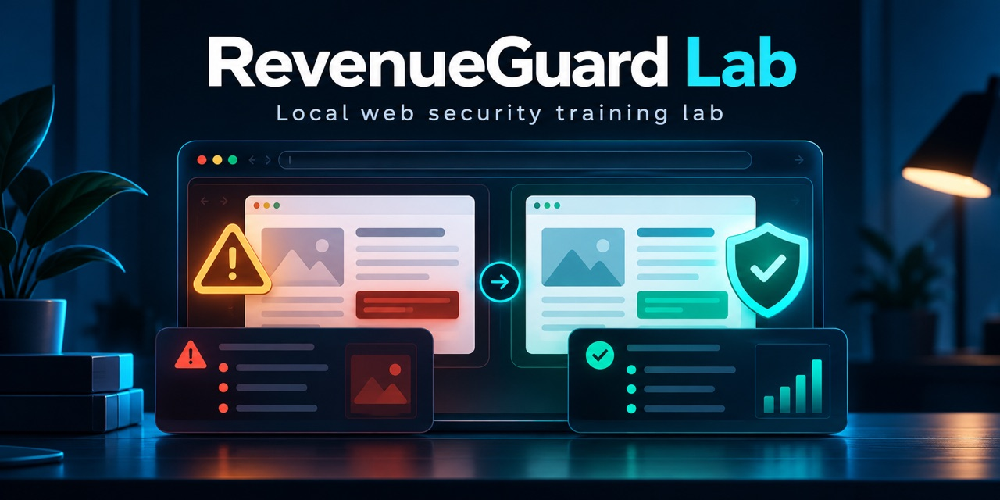

# RevenueGuard

RevenueGuard is a local, single-operator website security baseline scanner. It makes bounded, unauthenticated HTTPS GET requests to one public DNS origin at a time, follows eligible same-origin links, records limited response and markup observations, and produces a coverage report.

It is designed for websites you own or are explicitly authorized to review. Authorization is self-attested for each run and is not independently verified. GET requests can still trigger side effects on an unknown route.



## Start RevenueGuard

Requirements: Node.js 24.15 or newer. Runtime code has no npm dependencies.

```sh
git clone https://github.com/robialexz/revenueguard-lab.git
cd revenueguard-lab
node --version
npm start
```

Open <http://127.0.0.1:8765>. The app listens on loopback only. On first start it copies `scope.example.json` to the untracked local `scope.json` and creates `data/revenueguard.sqlite` for run history. No website is contacted during startup.

The default port is 8765. To use another port on a fresh checkout, first copy `scope.example.json` to `scope.json`, add the matching origin (for example `http://127.0.0.1:8877`) to `approvedOrigins`, then start with `REVENUEGUARD_PORT=8877 npm start`. The app still binds to loopback.

The checked-in example enables the synthetic fixture, local source review, and `web-scan`. Older scope files with `mode: "laboratory"` are migrated in memory to scanner mode and gain the `web-scan` capability. That migration selects no target and sends no request; each scan still requires a target URL and two per-run confirmations.

## Run an authorized web scan

1. Open **Web scan** and replace `https://<your-domain>/` with an absolute HTTPS URL for a public DNS hostname you own or are authorized to test. The hostname must resolve only to public addresses. IP literals, non-default ports, query strings, fragments, credentials, action-like routes, and token-shaped path segments are rejected.
2. Review the page, depth, request, duration, response-body, timeout, and delay budgets shown under **Scope & safety**. You may lower the per-run page and depth limits.
3. Confirm that you own the target or have permission to test it, and that unauthenticated GET requests are acceptable. Changing the target or either budget clears both confirmations.
4. Select **Start web scan**. Use **Stop scan** to abort the active request and prevent later pages from being requested. Requests already received by a server cannot be undone.
5. Review the findings and coverage report. An empty findings list is not a security verdict. The report records which checks ran, which routes were skipped, and where a budget or cancellation limited coverage.

The scanner does not log in, send cookies or credentials, submit forms, follow redirects, fetch static assets, or send exploit payloads. It skips query-string links, obvious action-like paths, ambiguous encoded paths, and links outside the starting HTTPS origin. It uses a bounded HTML tokenizer; it does not run JavaScript or discover routes that are only rendered by client-side code.

The baseline checks observe:

- HSTS, Content Security Policy, `X-Content-Type-Options`, Referrer-Policy, framing controls, and Permissions-Policy.
- TLS certificate-chain and hostname validation for the HTTPS connection.
- Cookie `Secure`, `HttpOnly`, and `SameSite` attribute counts, without retaining cookie names or values.
- A wildcard `Access-Control-Allow-Origin` header, without sending an `Origin` header or testing browser read access.
- Numeric software-version patterns in `Server` and `X-Powered-By` headers.
- HTTP resources embedded in HTTPS markup, form actions using HTTP, and missing Subresource Integrity on external scripts or stylesheets.

These are limited passive observations. RevenueGuard does not test authentication, access control, SQL injection, cross-site scripting, server-side request forgery, business logic, dependency advisories, or authenticated application behavior. It is not a comprehensive DAST or compliance tool. Heuristic action-path exclusions cannot identify every side-effecting GET route; do not scan routes with tokens, account actions, purchases, or sensitive identifiers.

## Other local workflows

- **Local fixture checks:** demonstrate intentionally vulnerable and secure behaviors against synthetic users, records, routes, and files bundled with RevenueGuard. They never target the supplied website.
- **Local source review:** inspect approved JavaScript and TypeScript directories for a small set of risky patterns. It is heuristic and does not execute or patch code.
- **HTTPS posture review and public page review:** optional one-GET-per-exact-page workflows configured with `passive-public-review` and `publicReadOnlyPages` in local `scope.json`. They are separate from the crawler and also require per-run consent.

See [Getting started](docs/getting-started.md) for configuration and workflow details.

## Local data and privacy

Run history is stored in `data/revenueguard.sqlite`. For web scans, the full starting URL is held in process memory only while that run is queued or active; local history stores the origin and aggregate observations, while findings and reports omit route paths. Response-header values are reduced to safe labels before storage. Startup removes paths saved by older web-scan builds from active records; it does not erase backups or guarantee forensic removal from old SQLite journal/free-page copies. Other configured exact-page workflows may retain their URLs in job history. Web-scan HTML response bodies, cookie names, and cookie values are not retained.

There is no automatic expiry or per-run deletion screen. Stop RevenueGuard and remove `data/revenueguard.sqlite` to clear local run history. Remove sensitive configured URLs separately from `scope.json`.

## Security boundary

- The dashboard binds to `127.0.0.1` on port 8765 by default and requires a same-origin CSRF token for mutations. `REVENUEGUARD_PORT` can select another loopback port. It has no user accounts or multi-tenant isolation; do not expose it on a network interface. `/api/health.externalNetworkEnabled` reports whether an external workflow is enabled, not whether a request is currently active.
- The web scanner allows HTTPS on port 443 for a single origin per run. Every DNS answer is checked against private and reserved address ranges; the chosen public address is pinned to the HTTPS connection, TLS verification remains enabled, and redirects are not followed.
- The crawler sends no authorization, cookies, referrer, form submissions, or probe payloads. Request, page, depth, duration, timeout, in-memory body-processing, and pacing budgets are enforced. Response bodies are buffered only for parsing, then discarded; a received network chunk can exceed the remaining in-memory allowance before the connection is stopped.
- Cancellation stops the current request and prevents queued routes from starting. A GET already received by a remote server may have had an effect.
- The operator confirmations record intent, not proof of ownership or permission.

For a hosted service, additional work would be required: identity and authorization, tenant isolation, a durable isolated worker queue, secret handling, data-retention controls, monitoring, and an independently reviewed network boundary. This repository is production-oriented for local single-operator use; it is not a hosted multi-user scanner.

## Verify a change

```sh
npm ci
npm run verify
```

`npm ci` installs only the development tools used by verification; it is not needed to run the app. The test suite uses synthetic code and injected transports. It does not send requests to an external website.

## License

No license has been added. Public visibility alone does not grant permission to reuse or redistribute this code.
